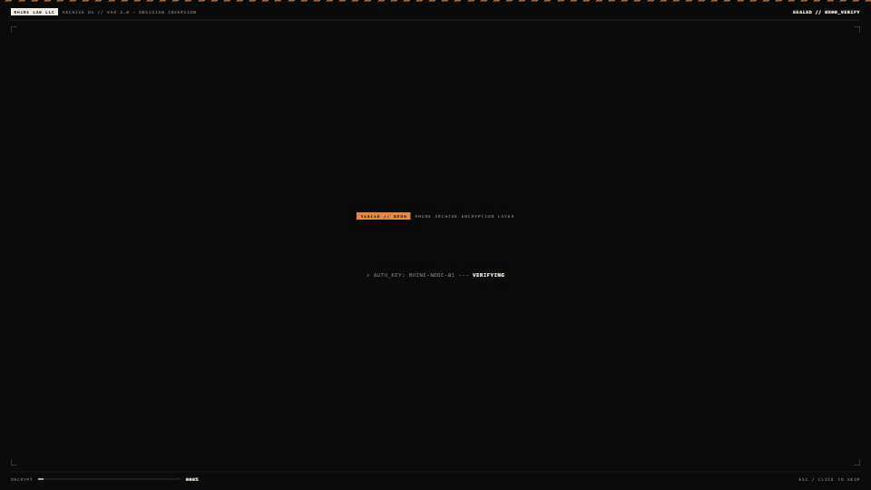
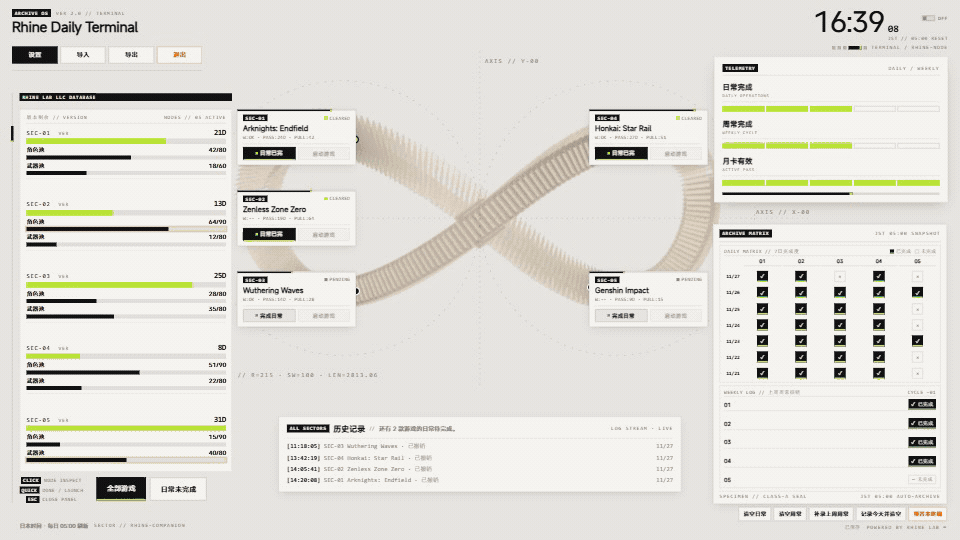

# Personal G Rhine Terminal

莱茵档案终端风格的 Windows 个人游戏日常 / 时长 / 账本一体化托管台。**WinForms + WebView2 独立桌面软件**：前端纯原生 HTML / CSS / JS + WebGL2 + WebAudio，不依赖外部浏览器、无需安装 Node.js 或 .NET SDK。

**下面是人写的：**
本项目起源于一个我的本地简陋小程序  借鉴了大佬的3D莫比乌斯带串联起了几个二游玩家常用的功能
99%的工作由Gemini 4（大部分前端设计 ui修改）  GPT6.2  （代码审查/codex耕地）
以及Deep seek v4.1（端茶送水 汇总项目状态 驱动codex）合作完成
如果有大佬愿意优化动画 ui 我感激不尽.jpg

另外，本地的harness接入以及自动计时勾选的watcher并没有随包附送，
但readme中有相关的tool的制作方法，可以在本地harness的帮助下很快部署并接入

**请务必在真实启动前摸清楚所有功能的实现方法！！！**
**请务摸清楚所有功能的实现方法！！！**
一部分功能存在外部依赖，
例如steam时长读取，是必须要电脑上有steam才行的，多账户情况需要选择主账号
另外时长检测的watcher一部分游戏（ZZZ，蓝原）是无法读到进程的，
需要额外配置才可以精准采集游戏时长
建议要部署前请交给AI打理建库，readme写的很详细了，相信豆包都能帮你弄好

已知缺陷
全屏适配仅完成了3440×1440@125%的完美适配
其他尺寸屏幕需要根据情况调整比例和缩放，可以交由本地Harness在短时间内完成

## 界面预览

### 启动序列（Obsidian Inversion · 黑曜石加密暗幕 → 光刃切开 → 240 片莫比乌斯环成型）


### 三态 3D 变形（莫比乌斯环日常台 → 莱茵浑天仪时长终端 → DNA 双螺旋账本）


## 核心功能

- **三态 3D 动力学界面**（长按画面中心 0.5s 循环切换，240 片独立标识叶片并发插值变形）：
  1. **日常观测台（莫比乌斯环 · 亮色）**：日常 / 周常打卡、月卡倒计时、卡池日期与抽数追踪、一键启动游戏、7 日归档矩阵（JST 05:00 自动切日）。
  2. **时长隔离终端（莱茵浑天仪 · 暗色）**：3A 单机与长线运营双扇区时长统计、极坐标圆盘、手动追踪筛选、本地与 Steam 时长每 60 秒自动同步。
  3. **消费账本（DNA 双螺旋 · 暗色）**：买断 / 抽卡双轨支出统计、周期筛选、单游明细档案与快速记账。
- **莱茵风格声效与终端 TTS**：全套事件驱动电子 UI 音效 + 统一声线英文终端语音（可在右上角开关静音）。
- **AI 桥接接口（BIONIC LINK）**：本地回环 HTTP 接口，支持 AI Agent 查询进度、自动勾选日常/周常、充月卡、记抽数、启动游戏。
- **后台进程追踪器（`tools/auto-daily`）**：纯 Python 标准库无侵入进程监测，游玩达标自动勾选日常并导出游玩时长。

---

## 环境依赖与启动

### 依赖项
- **主程序**：Windows 10/11（自带 `.NET Framework 4.x` 的 `csc.exe` 与 **Microsoft Edge WebView2 Runtime**）。WebView2 托管库已内置在 `build/lib/`，无需额外下载。
- **前端**：零外部依赖（原生 WebGL2 / WebAudio）。
- **后台 Watcher（可选）**：Python 3.11+（仅使用标准库，无需 `pip install` 任何第三方包）。

### 构建与运行
在仓库根目录运行 PowerShell：

```powershell
powershell -ExecutionPolicy Bypass -File "build\Start.ps1"
```

- 采用 SHA-256 指纹增量编译：仅当 `src/*.cs`、`build/lib/*.dll` 或图标变化时才重编译生成 `RhineTerminal.exe`；
- 前端 `web/` 资源修改保存即生效，重启窗口即可看到变化；
- 所有用户存档与配置自动保存在 `%LOCALAPPDATA%\PersonalGRhineTerminal\`（不会污染仓库目录）。

---

## 目录结构

```text
src/
  RhineTerminal.cs              WinForms + WebView2 宿主、本地静态资源与数据接口
  RhineTerminal.Assistant.cs    BIONIC LINK 本地回环 AI 接口（随机端口 + Token 鉴权）
web/                            前端界面（HTML / JS / CSS / WebGL2 / 音效与 TTS）
build/
  Start.ps1                     零 SDK 指纹编译并启动
  lib/                          WebView2 运行时 DLL（x64）
tools/
  auto-daily/                   Python 后台进程监控、自动勾选与 Steam/本地时长导出
  bionic/daily-helper/          可直接给 AI Agent 加载的 Skill 与 PowerShell 调用脚本
```

---

## 部署 AI 接口（BIONIC LINK）

软件启动后会自动在本地回环（`127.0.0.1` 随机端口 `20000–65000`）拉起受 Token 保护的 AI 接口，并将连接信息原子写入：

```text
%LOCALAPPDATA%\PersonalGRhineTerminal\assistant-endpoint.json
```

文件包含 `{ "port", "token", "pid", "version", "startedAt" }`，软件退出时自动清理。

### 第一步：在软件内开启授权
1. 启动 `RhineTerminal.exe`；
2. 点击左上角 **「设置」** → 勾选 **「允许 AI 操作（BIONIC LINK）」**。
   > 未勾选时所有外部 AI 请求会安全返回 `disabled`。

### 第二步：通过自带脚本或 Agent Skill 调用
仓库已内置完整封装脚本 `tools/bionic/daily-helper/scripts/daily-helper.ps1` 与 Agent Skill 文档 `tools/bionic/daily-helper/SKILL.md`（可直接复制到 Claude Code / Codex / Antigravity 等支持 Skill 的 AI 工具中）。

常用调用示例（返回标准 JSON，`ok: true` 表示执行成功）：

```powershell
# 1. 查询全部游戏及 ID、日常/周常/月卡/抽数状态
powershell -NoProfile -ExecutionPolicy Bypass -File "tools\bionic\daily-helper\scripts\daily-helper.ps1" -Action list

# 2. 勾选或取消日常 / 周常（-Field daily|weekly，-Done true|false）
powershell -NoProfile -ExecutionPolicy Bypass -File "tools\bionic\daily-helper\scripts\daily-helper.ps1" -Action set_completion -GameId "<游戏ID>" -Field daily -Done true

# 3. 充值月卡（+29天）、设置卡池日期、累加抽数、启动游戏
powershell -NoProfile -ExecutionPolicy Bypass -File "tools\bionic\daily-helper\scripts\daily-helper.ps1" -Action topup_monthcard -GameId "<游戏ID>"
powershell -NoProfile -ExecutionPolicy Bypass -File "tools\bionic\daily-helper\scripts\daily-helper.ps1" -Action set_pool_date -GameId "<游戏ID>" -PoolDate "2026-12-01"
powershell -NoProfile -ExecutionPolicy Bypass -File "tools\bionic\daily-helper\scripts\daily-helper.ps1" -Action add_pulls -GameId "<游戏ID>" -Pool character -Count 10
powershell -NoProfile -ExecutionPolicy Bypass -File "tools\bionic\daily-helper\scripts\daily-helper.ps1" -Action launch -GameId "<游戏ID>"
```

---

## 部署后台 Watcher（自动勾选日常 + 时长同步）

`tools/auto-daily/auto_daily.py` 使用纯 Python 标准库（`ctypes` 直调 Windows 进程快照 API），每 10 秒低开销巡检运行中的游戏进程：
- 检测到已配置游戏连续游玩达标（默认 120 秒）后，自动通过 **BIONIC LINK** 接口将对应游戏的「日常」勾选为已完成；
- 自动汇总本地进程时长与 Steam 本地库时长，每 60 秒原子导出到 `web/data/playtime.json` 供「时长隔离终端」实时展示。

### 1. 配置你的游戏路径规则
打开 `tools/auto-daily/auto_daily.py`，将顶部的游戏安装路径规则（`RULES`）替换为你本机的游戏目录与可执行文件名，确保游戏名称与终端设置里的名称一致。

### 2. 前台测试与一键自检
```powershell
cd tools\auto-daily

# 一键环境与接口自检（建议先启动 RhineTerminal.exe 并开启 AI 操作）
python auto_daily.py --doctor

# 手动导出一次 Steam + 本地时长快照
python auto_daily.py --write-playtime

# 前台启动监控（Ctrl+C 停止）
python auto_daily.py --watch
```

### 3. 注册 Windows 登录后静默后台自启
确保 `pythonw.exe` 在系统 `PATH` 中（或按需修改 `tools/auto-daily/start-watch.cmd` 里的解释器路径），在 `tools\auto-daily` 目录下执行：

```powershell
$run = 'HKCU:\Software\Microsoft\Windows\CurrentVersion\Run'
$launcher = (Resolve-Path -LiteralPath .\start-watch.cmd).Path
Set-ItemProperty -LiteralPath $run -Name AutoDailyWatch -Value ('"' + $launcher + '"')
cmd.exe /d /c .\start-watch.cmd
```

卸载开机自启并停止后台进程：

```powershell
powershell -NoProfile -ExecutionPolicy Bypass -File .\tools\uninstall-startup.ps1 -StopWatcher
```

更多细节（基准测试、Steam 分类微调、日志排障）见 [tools/auto-daily/README.md](tools/auto-daily/README.md)。

---

## 排障

- **请求与接口日志**：`%LOCALAPPDATA%\PersonalGRhineTerminal\requests.log`（超过 512 KB 自动轮转）。
- **AI 接口连不上**：确认 `RhineTerminal.exe` 已启动、设置里已开启「允许 AI 操作」，并运行 `python tools\auto-daily\auto_daily.py --doctor` 定位原因。
- **字体发虚**：宿主启动时已声明 Per-Monitor V2 DPI 感知；若异常请检查 `src/RhineTerminal.cs` 中 `EnableDpiAwareness()` 是否仍在 `Main` 入口首位。

---

## 致谢与声明

### 开源致谢
- 本项目中核心的 **3D 莫比乌斯叶片带子及其 WebGL2 渲染器（`web/rhine-motif.js`）** 是在开源项目 [rhine-lock](https://github.com/tmc5csxr9m-cpu/rhine-lock) 的基础上修改、重构并扩展三态变形而来的，特此向原作者致以诚挚感谢。
- `build/lib/` 内置的 `Microsoft.Web.WebView2.*.dll` 来源于 Microsoft Edge WebView2 SDK。

### 同人二创与非商业声明
- 本项目纯属**个人同人兴趣、非官方、非商业性质**的桌面日常小工具，与鹰角网络（Hypergryph）及《明日方舟》官方无任何关联。
- 界面中的「莱茵生命（Rhine Lab）」视觉美学、文案彩蛋及相关世界观设定均归原权利人所有。
- 仓库内附带的 `web/audio/` 音效与终端语音均为同人玩法下生成的非商业演示素材，仅用于个人本地体验与技术交流，请勿用于任何商业用途；如涉及任何权利或合规问题，请通过 Issue 联系，作者将第一时间配合移除。

